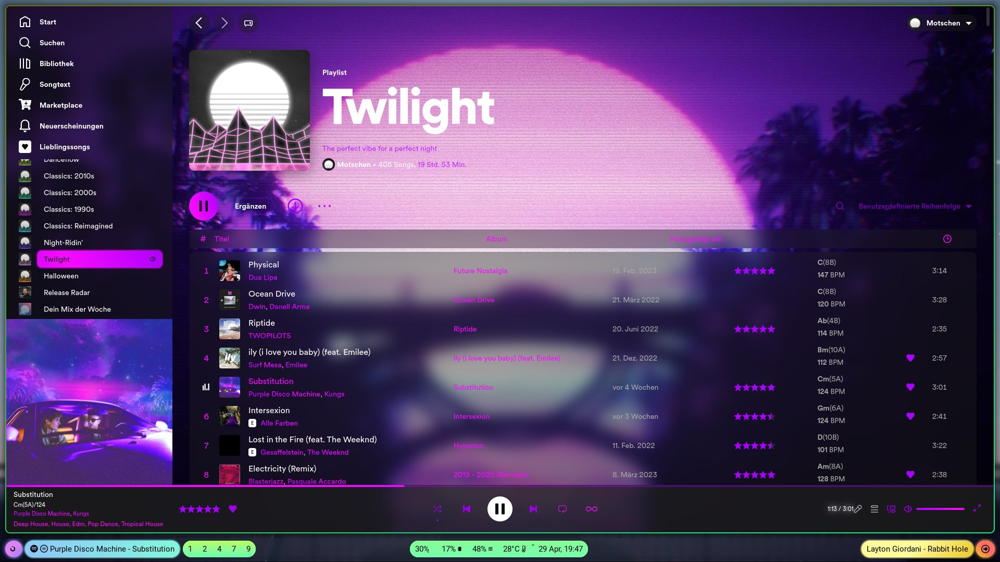
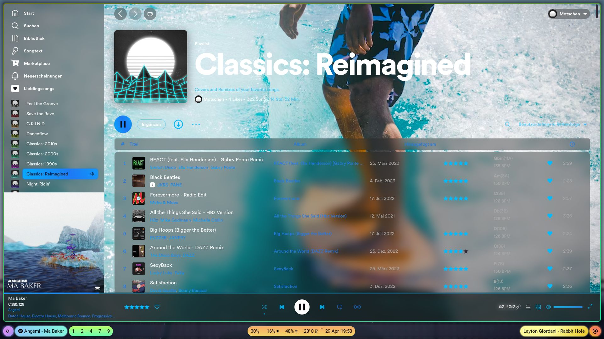
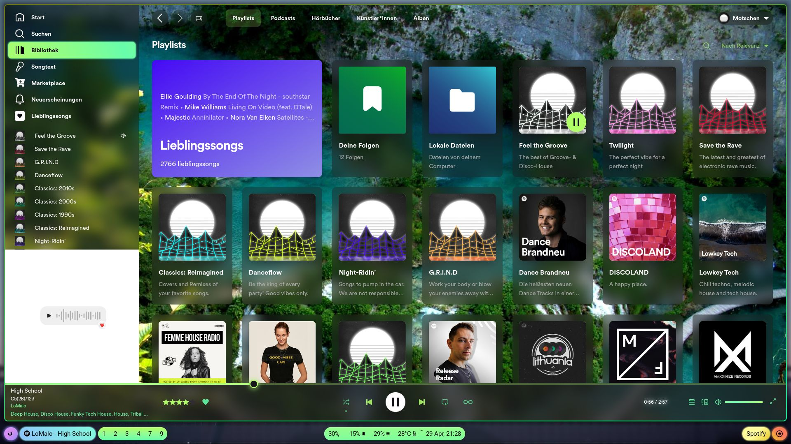
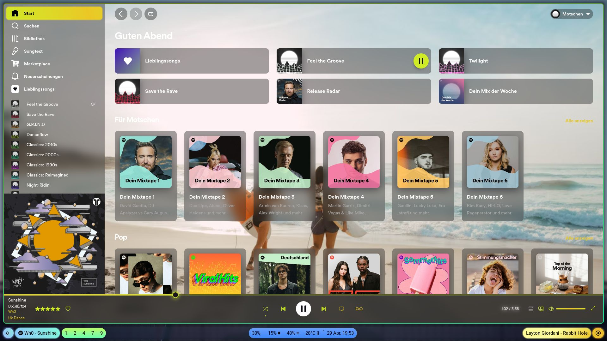
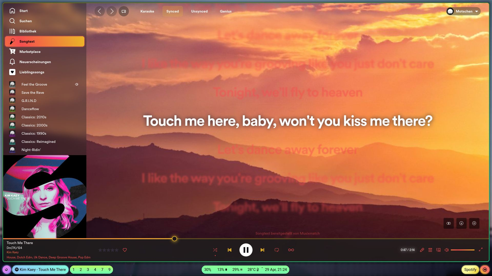
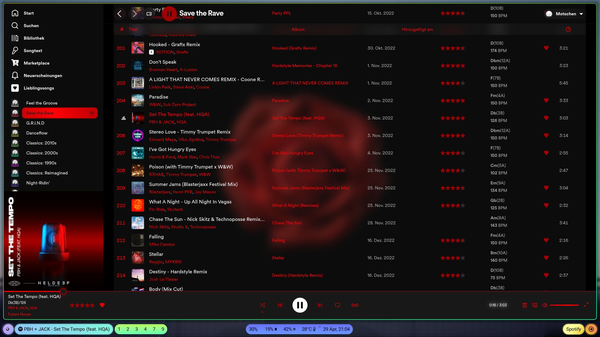
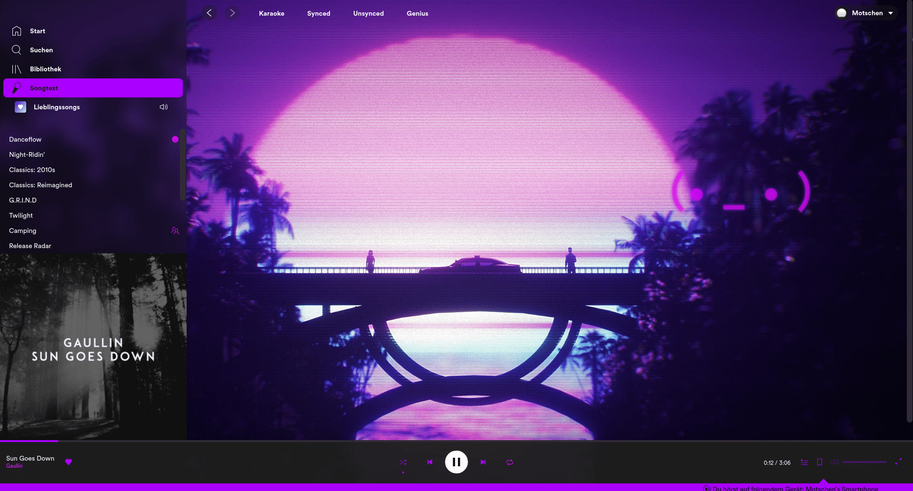

## Archival Notice – bye bye Spotify!
This theme has been archived, as I've stopped using Spotify for ethical concerns.  
Not only do artists (especially smaller ones) get [paid miserably](https://www.statista.com/chart/26100/average-amount-of-streams-needed-to-reach-payout-of-dollar1/), but the company leadership invests money in [questionable AI weapon producers](https://djmag.com/news/spotifys-daniel-ek-leads-eu600-million-investment-ai-military-defence-company) and [shady politicians](https://mixmag.net/read/spotify-donates-150000-trumps-inauguration-hosts-brunch-president-news).  As of recently, they've also started a [legal crackdown on mobile Spotify mods](https://www.youtube.com/watch?v=kgFCC9haqB4) – while Spicetify remains unaffected by this, who knows if it'll be next.  
If you want to continue using Spotify and this theme, feel free to fork it :)  
Otherwise, consider actually buying music – at least from your favourite small artists – or switch to another streaming service (there are many to choose from).

<h1 align="center">Retroblur</h1>

Spicetify theme with lots of blur, animations, hacks, gradients and retro elements. 
Based on https://github.com/schnensch0/ziro  
Copyright © 2023 Motschen - MIT License 

 

To change the color of the background, edit the link at the start of user.css  
It's sadly not possible to change the background together with the color scheme automatically due to the limitations of CSS.
 

